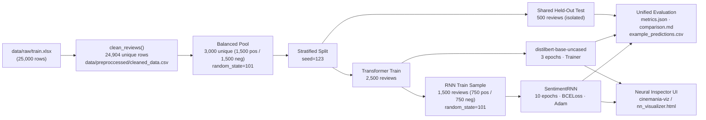

# Cinemania — IMDb Review Sentiment Classification


A reproducible, end-to-end NLP and Deep Learning benchmark for **Cinemania** that classifies English movie reviews as `positive` or `negative` using two independently trained architectures evaluated on the **exact same 500 held-out reviews**:

1. **`SentimentRNN` (Custom PyTorch):** Built from scratch with `nn.Embedding`, unidirectional `nn.RNN` (`pack_padded_sequence`), `nn.Linear`, and `nn.Sigmoid`.
2. **`distilbert-base-uncased` (Fine-Tuned Transformer):** Fine-tuned for 3 epochs via Hugging Face `datasets` and `Trainer`.

Includes an **interactive Neural Network & Transformer Visualizer UI** (`uv run cinemania-viz` and standalone [`reports/nn_visualizer.html`](reports/nn_visualizer.html)) to inspect real PyTorch weights, word-by-word RNN hidden states, and 6-layer × 12-head self-attention maps, plus a complete **[Zero-to-Hero Educational Guide](ZERO_TO_HERO_GUIDE.md)**.

---

## Table of Contents

- [Architecture & Pipeline](#architecture--pipeline)
- [Quickstart](#quickstart)
- [Project Structure](#project-structure)
- [Data Pipeline & Zero-Leakage Design](#data-pipeline--zero-leakage-design)
- [Model Specifications](#model-specifications)
- [CLI & Python API Usage](#cli--python-api-usage)
- [Interactive Neural Network Visualizer](#interactive-neural-network-visualizer)
- [Observed Results & Analysis](#observed-results--analysis)
- [Generated Artifacts & Reports](#generated-artifacts--reports)
- [Educational Guide & Next Experiments](#educational-guide--next-experiments)
- [Troubleshooting](#troubleshooting)
- [Author](#author)

---

## Architecture & Pipeline



---

## Quickstart

### Prerequisites
- **[uv](https://docs.astral.sh/uv/)** (package & environment manager)
- **Python 3.12** (pinned in `.python-version`)
- **Hardware:** Uses **CUDA** automatically when an NVIDIA GPU is present; falls back cleanly to **CPU**.
- **Dataset:** Local IMDb spreadsheet at `data/raw/train.xlsx` (never re-downloaded).

### 1. Install Dependencies
```bash
uv sync
```

### 2. Run the Full End-to-End Experiment
```bash
uv run python -m cinemania.run_experiment
```
Runs data loading, cleaning, shared splitting, RNN training (10 epochs), DistilBERT fine-tuning (3 epochs), evaluation on the shared 500-review test set, example predictions, and report generation.

### 3. Launch the Interactive Neural Network Visualizer
```bash
uv run cinemania-viz
```
Open `http://127.0.0.1:8765` to type any movie review and inspect real PyTorch neurons and self-attention heads live.

### 4. Run Unit Tests
```bash
uv run pytest -v
```

---

## Project Structure

```text
.
├── data/
│   ├── raw/                         # Local train.xlsx (25,000 rows; untouched)
│   └── preproccessed/
│       └── cleaned_data.csv         # Cleaned & deduplicated reviews (24,904 rows)
├── artifacts/
│   ├── splits/                      # Persisted parquet splits & metadata.json
│   ├── rnn/                         # sentiment_rnn.pt, vocab.json, config.json, train_results.json
│   └── transformer/
│       ├── checkpoint/              # Fine-tuned DistilBERT model & tokenizer
│       └── trainer_output/          # Trainer checkpoints, log_history.json, train_results.json
├── reports/
│   ├── metrics.json                 # Full machine-readable metrics & logs
│   ├── comparison.md                # Model comparison report & conclusion
│   ├── example_predictions.csv      # Required 3 example review predictions
│   └── nn_visualizer.html           # Standalone offline Neural Network Visualizer
├── src/cinemania/
│   ├── __init__.py                  # Lazy exports for predictors & label maps
│   ├── config.py                    # Centralized paths, seeds, labels & hyperparameters
│   ├── data/
│   │   ├── loading.py               # .xlsx/.csv discovery & column alias normalization
│   │   ├── preparation.py           # Cleaning, deduplication & shared 3,000-row splitting
│   │   └── rnn_encoding.py          # Regex tokenizer, 4,002-token vocab & dynamic collate
│   ├── models/
│   │   └── sentiment_rnn.py         # Custom PyTorch SentimentRNN module
│   ├── training/
│   │   ├── train_rnn.py             # 10-epoch PyTorch training & sample-weighted loss
│   │   └── train_transformer.py     # 3-epoch DistilBERT Trainer fine-tuning & evaluation
│   ├── inference/
│   │   └── predict.py               # Thread-safe cached RNN & Transformer predictors + CLI
│   ├── visualizer/
│   │   ├── inspector.py             # Extracts real PyTorch weights, hidden states & attentions
│   │   ├── server.py                # Hardened local HTTP server & standalone HTML exporter
│   │   └── static/index.html        # Graphite-themed HTML5 Canvas neural inspector UI
│   ├── evaluation.py                # Binary metrics & JSON/CSV/Markdown report writers
│   └── run_experiment.py            # Full & per-stage CLI runner
├── tests/
│   ├── conftest.py                  # Shared lightweight RNN & DistilBERT test fixtures
│   ├── test_data.py                 # Data loading, cleaning, splits & report writer tests
│   ├── test_rnn.py                  # Vocab, encoding, padding invariance & loss tests
│   ├── test_inference.py            # Offline saved-checkpoint inference & validation tests
│   └── test_visualizer.py           # Tensor extraction, HTTP validation & HTML export tests
├── ZERO_TO_HERO_GUIDE.md            # Complete Zero-to-Hero Neural Networks & PyTorch guide
├── pyproject.toml                   # Package metadata, dependencies & console scripts
├── uv.lock                          # Locked dependency graph
└── README.md
```

---

## Data Pipeline & Zero-Leakage Design

1. **Discovery & Validation ([`loading.py`](src/cinemania/data/loading.py)):** Discovers `data/raw/train.xlsx`, normalizes column names (`Reviews` -> `review`, `Sentiment` -> `sentiment`), and validates schema.
2. **Cleaning & Persistence ([`preparation.py`](src/cinemania/data/preparation.py)):**
   - Drops missing or whitespace-only reviews while preserving original review text untouched.
   - Canonicalizes `pos` -> `positive` and `neg` -> `negative` with explicit audit logging; raises `ValueError` on any unexpected label.
   - Detects and removes **96 duplicate reviews** (`0` conflicting labels), persisting **24,904 unique rows** (`12,472` positive, `12,432` negative) to `data/preproccessed/cleaned_data.csv`.
3. **Compatible Sample-Size Resolution:**
   - Samples a balanced pool of **3,000 unique reviews** (`1,500` positive, `1,500` negative, `random_state=101`).
   - Stratifies via `Dataset.train_test_split(test_size=500, seed=123)` into **2,500 Transformer training** rows and **500 shared held-out test** rows.
   - Samples **1,500 RNN training** rows (`750` positive, `750` negative, `random_state=101`) from the Transformer training partition and pairs them with the exact same **500 shared test** rows.
4. **Strict Isolation:** Held-out test reviews never touch RNN vocabulary construction, optimization, or checkpoint selection, and persisted splits in `artifacts/splits/` guarantee every stage evaluates identical rows.

---

## Model Specifications

| Parameter | `SentimentRNN` | `distilbert-base-uncased` |
|---|---|---|
| **Tokenization / Vocab** | Deterministic regex (`4,000` train tokens + `<pad>=0`, `<unk>=1` -> `4,002`) | Pretrained WordPiece (`30,522` tokens) |
| **Max Sequence Length** | `256` (dynamic per-batch padding + `pack_padded_sequence`) | `256` (truncation + padding) |
| **Architecture** | `nn.Embedding(4002, 128)` -> `nn.RNN(128, 256)` -> `nn.Linear(256, 1)` -> `nn.Sigmoid()` | 6-layer Transformer, 12 attention heads, 768 hidden dim + sequence classifier |
| **Loss & Optimizer** | `BCELoss`, `Adam(lr=0.001)` | Cross-Entropy, Hugging Face `Trainer` (`AdamW`) |
| **Training Schedule** | `10` epochs, batch size `32` | `3` epochs, train batch size `8`, `logging_steps=100` |
| **Train / Test Split** | `1,500` train / `500` shared test | `2,500` train / `500` shared test |

---

## CLI & Python API Usage

### Run Individual Pipeline Stages
```bash
uv run python -m cinemania.run_experiment --stage prepare
uv run python -m cinemania.run_experiment --stage rnn
uv run python -m cinemania.run_experiment --stage transformer
uv run python -m cinemania.run_experiment --stage evaluate
```

### Run Inference from the Command Line
```bash
# Run both models on the three required example reviews
uv run cinemania-predict --examples

# Classify custom unseen English reviews
uv run cinemania-predict "An unforgettable masterpiece with brilliant acting."
```

### Run Inference from Python
```python
from cinemania import predict_sentiment_rnn, predict_sentiment_transformer

review = "The cinematography was stunning, though the pacing dragged in the second half."
rnn_result = predict_sentiment_rnn(review)
tf_result = predict_sentiment_transformer(review)

print(rnn_result)
# {'model': 'rnn', 'label': '...', 'confidence': 0.xxxx, 'probabilities': {'negative': ..., 'positive': ...}}
print(tf_result)
# {'model': 'transformer', 'label': '...', 'confidence': 0.xxxx, 'probabilities': {'negative': ..., 'positive': ...}}
```

---

## Interactive Neural Network Visualizer

Inspect real PyTorch weights, word-by-word hidden states, and DistilBERT multi-head self-attention:

```bash
# Start live local server on http://127.0.0.1:8765
uv run cinemania-viz

# Use a custom port
uv run cinemania-viz --port 9000

# Export standalone offline HTML snapshot
uv run python -m cinemania.visualizer --export reports/nn_visualizer.html
```

- **`SentimentRNN` (`1`):** Cubic-Bézier synaptic graph (`Token -> Embedding -> Hidden -> Sigmoid`) with hover focus isolation, `W_hh` recurrent loops, a clickable word-by-word `P(positive)` trajectory chart, keyboard transport (`Space`, `←`, `→`), and a 64-unit hidden layer snapshot.
- **`DistilBERT` (`2`):** Vertical bipartite self-attention ribbon graph across all **6 layers** and **12 heads** (or 12-head average), ranked attention targets, and `[CLS]` block L2 norms.

---

## Observed Results & Analysis

Executed on `device=cuda` (`GLOBAL_SEED=42`):

### Held-Out Test Comparison (500 Shared Reviews)

| Model | Train Samples | Test Samples | Final Train Loss | Test Loss | Accuracy | Precision | Recall | F1-score |
|---|---:|---:|---:|---:|---:|---:|---:|---:|
| `SentimentRNN` (10 epochs) | 1,500 | 500 | `0.0317` | `2.0847` | `0.5240` | `0.5234` | `0.5360` | `0.5296` |
| `distilbert-base-uncased` (3 epochs) | 2,500 | 500 | `0.2538` | `0.5397` | `0.8800` | `0.8862` | `0.8720` | `0.8790` |

### `SentimentRNN` Epoch Loss Trajectory

| Epoch | 1 | 2 | 3 | 4 | 5 | 6 | 7 | 8 | 9 | 10 |
|---|---:|---:|---:|---:|---:|---:|---:|---:|---:|---:|
| **Train Loss** | `0.7097` | `0.6105` | `0.5379` | `0.4560` | `0.3823` | `0.2781` | `0.1839` | `0.1075` | `0.0631` | `0.0317` |

> **Interpretation & Caveat:** `SentimentRNN` memorized its 1,500 training sequences (driving train loss to `0.0317`) while generalizing poorly (`2.0847` test loss, `52.4%` accuracy) due to vanishing gradients and lack of pretraining over long 256-token sequences. `distilbert-base-uncased` achieved `88.0%` accuracy and `0.8790` F1 using pretrained contextual self-attention. Because training sizes differ (`1,500` vs `2,500`) per assignment specification, this benchmark compares the two prescribed workflows rather than isolating architecture alone.

### Required Example Review Predictions

| Category | Review | RNN Prediction (Conf.) | Transformer Prediction (Conf.) |
|---|---|---|---|
| `negative-oriented` | I had been looking forward to this film for a long time, but I did not like it at all. | `negative` (`0.9996`) | `negative` (`0.8308`) |
| `positive-oriented` | The cast is excellent, and the plot is very interesting. | `positive` (`0.9994`) | `positive` (`0.9990`) |
| `mixed` | The film's visual effects are good, but the story is weak. | `negative` (`0.9920`) | `negative` (`0.9975`) |

---

## Generated Artifacts & Reports

- [`data/preproccessed/cleaned_data.csv`](data/preproccessed/cleaned_data.csv) — Cleaned, deduplicated IMDb reviews (`24,904` rows).
- [`reports/metrics.json`](reports/metrics.json) — Machine-readable cleaning stats, split counts, epoch losses, and evaluation metrics.
- [`reports/comparison.md`](reports/comparison.md) — Formatted comparison report with sample-size disclosure and conclusion.
- [`reports/example_predictions.csv`](reports/example_predictions.csv) — Predictions for the three required example reviews.
- [`reports/nn_visualizer.html`](reports/nn_visualizer.html) — Self-contained interactive Neural Network & Transformer Visualizer snapshot.

---

## Educational Guide & Next Experiments

- Read **[`ZERO_TO_HERO_GUIDE.md`](ZERO_TO_HERO_GUIDE.md)** for a complete beginner-to-advanced guide covering Neural Networks, PyTorch mastery, Transformer math & platform design, and building interactive NN visualizers.
- **Suggested experiments to try next:**
  1. Swap `nn.RNN` for `nn.LSTM` or `nn.GRU` with dropout and compare held-out accuracy against `0.5240`.
  2. Run an equal-sample ablation (training DistilBERT on the same 1,500 rows) to isolate architecture from dataset size.
  3. Add weight decay (`weight_decay=1e-4`) or gradient clipping to `SentimentRNN` to measure its effect on test loss (`2.0847`).

---

## Troubleshooting

- **Missing checkpoint errors during inference or visualizer startup:** Run `uv run python -m cinemania.run_experiment` first to generate `artifacts/rnn/` and `artifacts/transformer/checkpoint/`.
- **Offline environments:** After initial `uv sync` and caching `distilbert-base-uncased`, all training, inference, visualizer, and test commands run completely offline (`train_transformer.py` falls back to `local_files_only=True`).
- **CPU-only machines:** No flags required—`get_device()` selects CUDA when available and falls back to CPU automatically.

---

## Author

- **Abdumalik-ProDev** — GitHub: [https://github.com/Abdumalik-ProDev](https://github.com/Abdumalik-ProDev)
